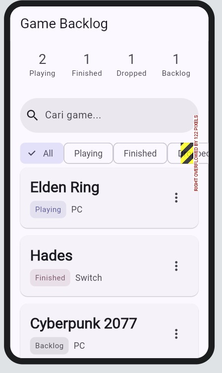
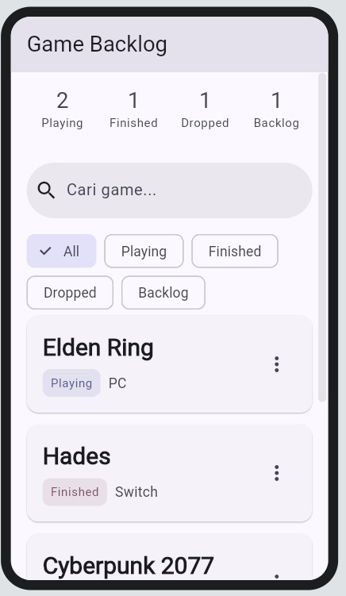
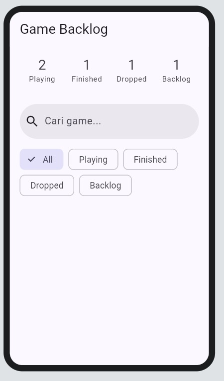
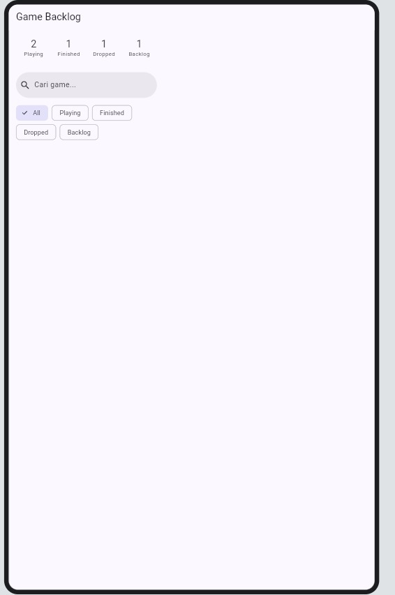
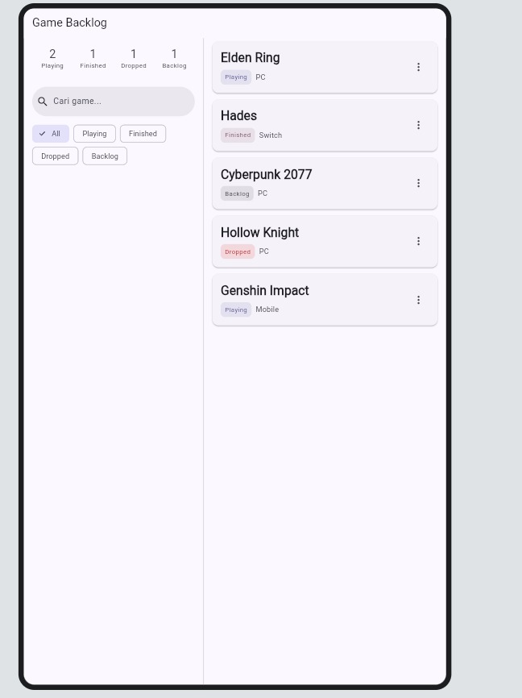

# Constraint Diagnosis

Tiga error di bawah ini dibuat sengaja dengan merusak widget di aplikasi Game Backlog sendiri, difoto, lalu diperbaiki lagi. Kode akhir di repo sudah dalam keadaan benar (versi perbaikan).

Aturan dasar yang dilanggar di ketiganya: **constraints go down, sizes go up, parent sets position.** `Row` dan `Column` memberi anak non-flex ruang tak terbatas pada sumbu utamanya, sehingga anak harus punya ukuran sendiri atau dibungkus `Expanded` / `Flexible`.

## 1. Chip filter di `Row` (bukan `Wrap`)

Lokasi: `lib/features/widgets/status_filter_chips.dart`. Diuji di layar 320 dp.



- **Error:** `A RenderFlex overflowed by N pixels on the right.`
- **Aturan yang dilanggar:** `Row` memberi tiap chip lebar tak terbatas dan tidak pernah membungkus ke baris baru, jadi jumlah lebar kelima chip melebihi lebar layar.
- **Perbaikan:** kembalikan `Row` menjadi `Wrap` supaya chip turun ke baris berikutnya.

```dart
Wrap(
  spacing: 8,
  runSpacing: 8,
  children: [ /* ChoiceChip... */ ],
)
```



## 2. `ListView` di dalam `Column` tanpa `Expanded`

Lokasi: `_buildNarrow()` di `lib/features/screens/backlog_screen.dart`. Diuji di layar 320 dp.



- **Error:** `Vertical viewport was given unbounded height.`
- **Aturan yang dilanggar:** `Column` memberi anak non-flex tinggi tak terbatas, sedangkan `ListView` butuh tinggi terbatas untuk tahu berapa banyak item yang perlu digambar.
- **Perbaikan:** bungkus `ListView` dengan `Expanded` supaya tingginya sama dengan sisa ruang.

```dart
Column(
  children: [
    _controls(),
    Expanded(child: ListView.builder(/* ... */)),
  ],
)
```


## 3. Daftar di `Row` tanpa `Expanded` (layout tablet)

Lokasi: `_buildWide()` di `lib/features/screens/backlog_screen.dart`. Diuji di layar 800 dp.


- **Aturan yang dilanggar:** `Row` memberi anak non-flex lebar tak terbatas, sedangkan `ListView` vertikal butuh lebar terbatas dari parent untuk menentukan lebar item.
- **Perbaikan:** bungkus daftar dengan `Expanded` supaya lebarnya sama dengan sisa ruang setelah panel kiri.

```dart
Row(
  children: [
    SizedBox(width: 340, child: SingleChildScrollView(child: _controls())),
    const VerticalDivider(width: 1),
    Expanded(child: ListView.builder(/* ... */)),
  ],
)
```


